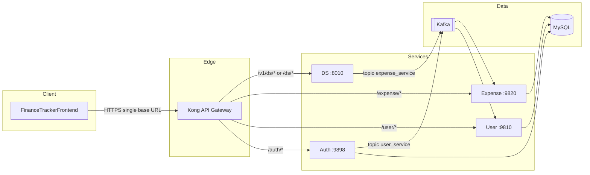
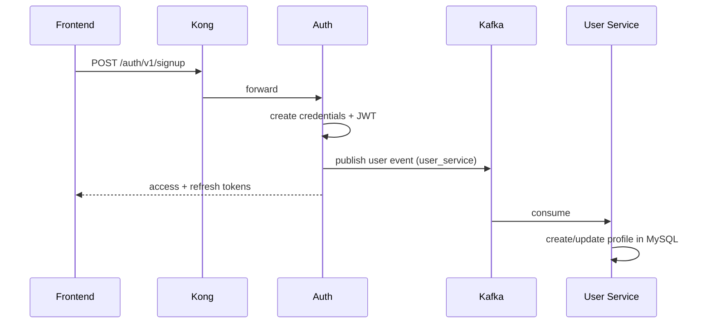
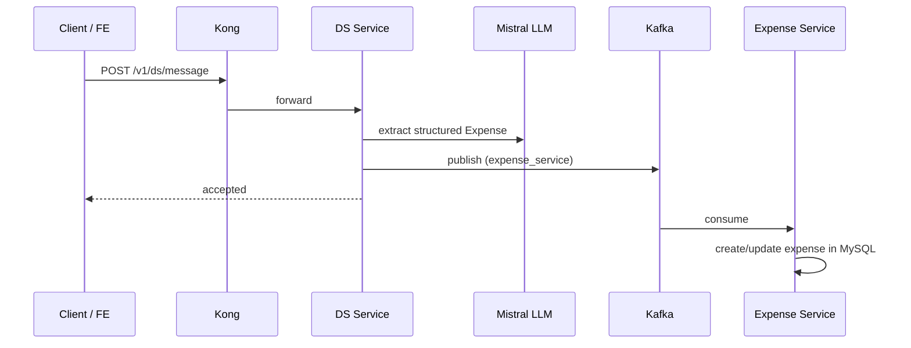

# Finance Tracker — Architecture & Methodology

This document is the **system map** for the Finance Tracker application. Individual services live in separate GitHub repos; this file explains how they fit together, what each repo owns, and where **Kong** sits.

> Hub repo: [FinanceTrackerApplication](https://github.com/sukeerthreddy12/FinanceTrackerApplication) (auth service)

---

## What the product is

Finance Tracker is a **microservices** expense app:

1. Users sign up / log in (JWT).
2. Profile data is kept in a dedicated user service.
3. Users can add spends via the UI, or send **natural-language** messages that a DS/LLM service turns into structured expenses.
4. Expenses are stored by the expense service.
5. The React frontend never talks to each service’s host/port directly in production — it talks to **one Kong API gateway URL**.

---

## Repositories

| Repo | Role |
|------|------|
| [FinanceTrackerApplication](https://github.com/sukeerthreddy12/FinanceTrackerApplication) | **Auth** — signup, login, refresh, logout, JWT; publishes user events to Kafka |
| [FinanceTrackerUserService](https://github.com/sukeerthreddy12/FinanceTrackerUserService) | **User** — profile create/update/get; consumes auth user events from Kafka |
| [FinanceTrackerExpenseService](https://github.com/sukeerthreddy12/FinanceTrackerExpenseService) | **Expense** — persist and list expenses; consumes expense events from Kafka |
| [FinanceTrackerDsService](https://github.com/sukeerthreddy12/FinanceTrackerDsService) | **DS** — NLP/LLM extraction of expenses from free text; publishes to Kafka |
| [FinanceTrackerFrontend](https://github.com/sukeerthreddy12/FinanceTrackerFrontend) | **Web UI** — React/Vite app; calls Kong with `VITE_API_BASE_URL` |

**Not a service repo (infra):** Kafka, MySQL, and Kong run in Docker. Local compose / Kong declarative config currently lives under the workspace `jars/` folder (`services.yaml`, `kong.yaml`) — deploy those with your Docker host, not inside an app repo.

---

## High-level architecture



---

## How Kong chips in

Kong is the **only public HTTP entry** for backends.

- Frontend sets `VITE_API_BASE_URL` to the Kong (or load-balancer) URL.
- Kong **routes by path prefix** to the right container/service:
  - `/auth` → auth-service (`9898`)
  - `/user` → user-service (`9810`)
  - `/expense` → expense-service (`9820`) — add this route in Kong if not already present
  - DS message API (`/v1/ds/message`) → ds-service (`8010`) — add an explicit Kong route for production
- `strip_path: false` keeps the full path (`/auth/v1/login`, etc.) so Spring/Flask controllers keep working unchanged.
- Benefits: one CORS/TLS place, hide internal Docker IPs, swap service hosts without changing the frontend.

Example declarative shape (IPs/hosts should be **Docker service names**, not hard-coded bridge IPs, in real deploy):

```yaml
services:
  - name: auth-service
    url: http://auth-service:9898
    routes:
      - paths: ["/auth"]
        strip_path: false
  - name: user-service
    url: http://user-service:9810
    routes:
      - paths: ["/user"]
        strip_path: false
```

---

## Async flows (Kafka)

### 1) Signup → user profile



### 2) Natural-language spend → expense row



HTTP expense APIs (`/expense/v1/...`) also exist for direct create/list from the UI.

---

## Methodology (how we build & run)

1. **One repo per deployable** — auth, user, expense, ds, frontend. No monorepo; each can version and deploy alone.
2. **Secrets stay local** — `.env` gitignored; commit only `.env.example` with placeholders.
3. **Config via env** — MySQL/Kafka/JWT/API keys injected at runtime (Docker `env_file` or local `.env`).
4. **Sync vs async**
   - Sync: anything the UI needs immediately (login, get expenses) → HTTP through Kong.
   - Async: cross-service side effects (profile after signup, LLM→expense) → Kafka topics.
5. **Contract by path** — gateway paths mirror controller prefixes (`/auth/v1`, `/user/v1`, `/expense/v1`, `/v1/ds`).
6. **Local stack** — Docker for MySQL + Kafka (+ Kong); run each service with its README `bootRun` / `npm run dev` / Flask entry.

---

## Typical request paths (frontend → Kong)

| UI action | Path |
|-----------|------|
| Signup | `POST /auth/v1/signup` |
| Login | `POST /auth/v1/login` |
| Refresh | `POST /auth/v1/refreshToken` |
| Session check | `GET /auth/v1/ping` |
| Get / update profile | `/user/v1/...` |
| List / add expense | `/expense/v1/...` |
| NL message → expense | `POST /v1/ds/message` |

---

## Why the architecture doc lives here

Auth is the **security and identity boundary** of the backend and was the first published service repo. Treat this file as the cross-repo map; every other README links back here so people don’t hunt for the big picture.
